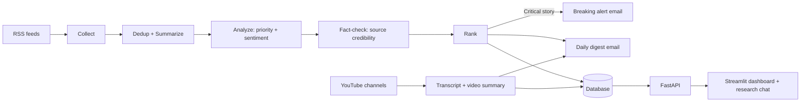

# AI Briefing Agent

An autonomous multi-agent AI system that collects news (RSS) and YouTube videos, summarizes and analyzes them with Google Gemini, and delivers a personalized daily briefing, breaking-news alerts and a weekly intelligence report by email. It also has a REST API, a Streamlit dashboard and a research chat that answers questions from the collected news with source citations (RAG).

## Features

- **Collection:** RSS news feeds (BBC, Dawn, TechCrunch) and YouTube channels (RSS + transcripts)
- **Deduplication:** the same story from several outlets is merged (TF-IDF + cosine similarity)
- **AI summaries:** 2-3 sentence summaries of every story; YouTube videos get a summary, key points and a takeaway
- **Analysis:** priority (Critical / High / Medium / Low) and sentiment (positive / negative / neutral) in a single LLM call
- **Source credibility:** stories confirmed by 2+ independent outlets are labelled; single-source stories are flagged
- **Breaking alerts:** an immediate email when a Critical story appears (never sent twice for the same story)
- **Daily digest and weekly report:** ranked stories, YouTube highlights, trending topics (new / rising / falling) and week-over-week comparison
- **Research chat (RAG):** semantic search with Gemini embeddings (TF-IDF fallback), answers with citations, refuses to answer when the news does not contain the answer
- **API and dashboard:** FastAPI endpoints and a Streamlit dashboard (Stories, Videos, Stats, Chat)

## Architecture



The pipeline is orchestrated with **LangGraph** (conditional branches skip work when there is nothing new and add the alert step only for Critical stories). A second, lightweight graph runs every 30 minutes for breaking alerts.

## Tech stack

Python, FastAPI, LangGraph, Google Gemini (summaries, analysis, embeddings), scikit-learn, SQLAlchemy (SQLite by default, PostgreSQL supported), APScheduler, Streamlit, feedparser, youtube-transcript-api, Docker Compose.

## Quick start

```bash
python -m venv venv
venv\Scripts\activate            # Windows (Linux/Mac: source venv/bin/activate)
pip install -r requirements.txt
copy .env.example .env           # then fill in your Gemini key and Gmail App Password
```

```bash
python -m app.scheduler --digest-now --all   # build and email a digest now
uvicorn app.main:app --reload                # API on http://127.0.0.1:8000/docs
streamlit run dashboard/app.py               # dashboard on http://localhost:8501
python -m app.scheduler                      # daily digest, 30-minute alerts, weekly report
python -m pytest tests -q                    # run the test suite
```

Docker Compose files (PostgreSQL + API + scheduler + dashboard) are included: `docker-compose up --build -d`.

## API

`GET /health`, `/stories`, `/articles`, `/stats`, `/videos`, `/weekly` and `POST /chat`, `/run-digest`, `/run-alerts`, `/run-videos`, `/run-weekly`. Interactive docs at `/docs`.

## Project structure

## Notes and limitations

- Facebook, Instagram and X are not included because their APIs are restricted or paid.
- YouTube transcripts use the unofficial `youtube-transcript-api` library. It works locally, but YouTube often blocks cloud IP addresses. Videos without a transcript are summarized from the title and description and are labelled as such.
- Emails are sent through Gmail SMTP with an App Password.
- Source credibility is rule-based (independent outlets that reported the story), not a claim-by-claim fact check.
