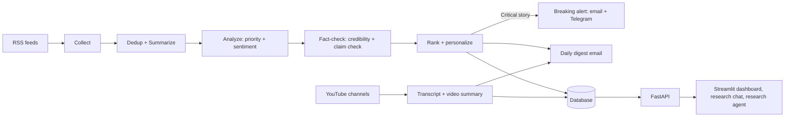

# AI Briefing Agent

> An autonomous multi-agent AI system that reads news and YouTube for you, analyzes everything with Google Gemini, and delivers a prioritized daily briefing, breaking-news alerts (email and Telegram) and a weekly intelligence report. It also ships a REST API, a Streamlit dashboard and a research chat that answers questions from the collected news with source citations (RAG).

**Status:** working end to end, deployed on Render with GitHub Actions scheduling, covered by 311 automated tests that all run offline (85% coverage), with lint and a coverage gate in CI. Accounts, personal feeds, per-user digests and migrations are in place. Next: production hardening (rate limiting, logging), then Docker verification (see the roadmap below).

## Project summary

Keeping up with news means opening many sites, feeds and videos every day. This project does that work automatically:

1. **Collects** articles from RSS feeds and new videos (with transcripts) from YouTube channels.
2. **Merges** the same story reported by several outlets and **summarizes** it with Gemini.
3. **Analyzes** every story: priority (Critical / High / Medium / Low), sentiment, and how many independent sources confirm it.
4. **Delivers** a ranked daily email, an immediate alert for Critical stories (email and Telegram) and a weekly report with trending topics.
5. **Answers questions** about the collected news (also in Roman Urdu / Hinglish) with citations, and refuses to answer when the news does not contain the answer.

## Features

- **Collection:** RSS feeds (BBC, Dawn, TechCrunch, The Guardian) and YouTube channels (RSS plus transcripts); one failing source never stops the rest
- **Deduplication:** the same story from several outlets is merged by TF-IDF similarity and shared title keywords
- **AI summaries:** 2-3 sentence story summaries; YouTube videos get a summary, key points and a takeaway
- **Analysis:** priority and sentiment for all stories in a single LLM call, with safe defaults if the model answers badly
- **Source credibility:** "Confirmed by N sources" versus "Single source"
- **Claim check:** one LLM call compares how outlets report the same story; stories where key details differ are labelled "Details differ"
- **Breaking alerts:** an immediate email and Telegram message for Critical stories, never sent twice for the same story; a Telegram failure never blocks the pipeline
- **Personalization:** your interests (dashboard sidebar, `PUT /interests`, or the `INTERESTS` setting) move matching stories up one priority tier, never above High or Critical
- **Daily digest and weekly report:** ranked stories, YouTube highlights, trending topics and a week-over-week comparison
- **Research chat (RAG):** semantic search with Gemini embeddings (cached, TF-IDF fallback), answers with citations
- **Research agent:** a topic is split into sub-questions, each is searched in the collected news, and one grounded report is written with citations and a "Not covered" section
- **Accounts:** register and login with signed tokens, salted PBKDF2 password hashes and per-user interests
- **Personal feed:** `GET /me/feed` re-ranks stored stories by the logged-in user's own interests
- **Per-user digest:** opted-in users get their own daily email, ranked by their interests, at most one per day
- **API and dashboard:** FastAPI endpoints and a Streamlit dashboard (Stories, Videos, Stats, Chat, Research, My feed)

## Architecture



The daily pipeline is orchestrated with **LangGraph**: conditional edges skip all work (and all API calls) when nothing is new, and add the alert step only when a Critical story exists. A second, lightweight graph checks for breaking alerts and makes a single LLM call.

## Tech stack

Python 3.11, FastAPI, LangGraph, Google Gemini (summaries, analysis, embeddings), scikit-learn, SQLAlchemy with Alembic migrations (SQLite by default, PostgreSQL supported), APScheduler, Streamlit, feedparser, youtube-transcript-api, pytest, Docker Compose, GitHub Actions, Render.

## Quick start

```bash
python -m venv venv
venv\Scripts\activate            # Windows (Linux/Mac: source venv/bin/activate)
pip install -r requirements.txt
copy .env.example .env           # Windows (Linux/Mac: cp .env.example .env), then fill in your Gemini key and Gmail App Password
```

```bash
python -m app.scheduler --digest-now --all   # build and email a digest now
uvicorn app.main:app --reload                # API on http://127.0.0.1:8000/docs
streamlit run dashboard/app.py               # dashboard on http://localhost:8501
python -m app.scheduler                      # daily digest, alerts, weekly report
python -m pytest tests -q                    # run the test suite
python -m app.core.migrate                   # create or upgrade the database schema
```

A Docker Compose setup (PostgreSQL, API, scheduler, dashboard) is included: `docker compose up --build -d`.

## Configuration

Copy `.env.example` to `.env`. Main settings: `GEMINI_API_KEY`, `EMAIL_SENDER`, `EMAIL_PASSWORD`, `EMAIL_RECEIVER`, `DATABASE_URL`, `API_KEY`, `DASHBOARD_PASSWORD`, `INTERESTS` (comma-separated keywords, optional), `TELEGRAM_BOT_TOKEN` and `TELEGRAM_CHAT_ID` (optional). Accounts need `AUTH_SECRET` (a long random string; leave it empty to switch accounts off) and optionally `AUTH_TOKEN_HOURS` (token lifetime, default 72).

### Telegram setup

1. Message `@BotFather` on Telegram, send `/newbot` and copy the token.
2. Send `/start` to your new bot.
3. Open `https://api.telegram.org/bot<TOKEN>/getUpdates` and read `chat.id`.
4. Put both values in `.env` (and in the Render service environment). Never commit them.

## API

`GET /health`, `/stories`, `/articles`, `/stats`, `/videos`, `/weekly`, `/interests`, `PUT /interests`, and `POST /chat`, `/research`, `/run-digest`, `/run-alerts`, `/run-videos`, `/run-weekly`. Interactive docs are served at `/docs`. The core endpoints require the `X-API-Key` header when `API_KEY` is set.

Account endpoints use `Authorization: Bearer <token>`: `POST /auth/register`, `POST /auth/login`, `GET /me`, `PUT /me/interests`, `GET /me/feed`, `GET /me/delivery` and `PUT /me/delivery` (daily digest on/off).

## Deployment

The API and dashboard run on Render (`render.yaml`). GitHub Actions (`scheduled.yml`) wakes the service and calls `/run-digest`, `/run-alerts` and `/run-weekly` on a schedule. Secrets (`API_URL`, `API_KEY`) live in the repository's Actions secrets.

## Project structure

```
app/
  main.py, pipeline.py, scheduler.py, video_pipeline.py, weekly.py
  agents/      summarizer, analyzer, factchecker, claim_checker, ranker,
               alert_agent, email_agent, research, deep_research,
               video_agent, weekly_email, user_digest
  api/         routes, security, auth
  collectors/  rss, youtube
  core/        config, database, models, storage, dedup, embeddings,
               search_store, interests, mailer, telegram_notifier, story, video,
               users, tokens, personalize, migrate
  graph/       briefing (daily pipeline), alerts (breaking alerts)
dashboard/     Streamlit app, accounts UI, API client, helpers
tests/         automated tests (all external services are faked)
migrations/    Alembic migration scripts (baseline 0001)
.github/workflows/  tests.yml (CI), scheduled.yml (calls the deployed API)
render.yaml, docker-compose.yml, Dockerfile
```

## Development progress

### Completed

| # | Step | What was built |
|---|------|----------------|
| 1-21 | Core system | Environment, structure, config, RSS, database and dedup, Gemini summaries, pipeline, email digest, scheduler, priority and sentiment, source credibility, LangGraph orchestration, breaking alerts, REST API, research chat (RAG) with embeddings, dashboard, YouTube intelligence, weekly report, Docker and PostgreSQL support, GitHub |
| 22 | CI | GitHub Actions workflow running the test suite on every push |
| 23 | Telegram notifier | Standalone notifier module with offline tests |
| 24 | Telegram alerts | Critical stories also go to Telegram after the email; failures never block the pipeline |
| 25 | Personalization | Interests setting moves matching stories up one tier, never above High or Critical |
| 25b | Interests API | Interests stored in the database (GET/PUT /interests) |
| 25c | Dashboard form | Sidebar form to edit interests |
| 26 | Claim check | One LLM call flags stories where outlets disagree on key details |
| 27 | Research agent | Multi-step report with citations (POST /research, Research tab) |
| 27b | Cross-outlet dedup | Same story from different outlets merged by title keywords; stricter Critical prompt |
| 28 | Offline RSS tests | RSS collector tests use fake feeds; the whole suite runs without internet |
| 29 | Quality gate in CI | ruff lint and a minimum 80% coverage check run on every push |
| 30 | Accounts core | Users table, salted PBKDF2 password hashing, signed login tokens, `/auth/register`, `/auth/login`, `/me`, `/me/interests` |
| 31 | Personal feed | `GET /me/feed` re-ranks stored stories by the logged-in user's own interests |
| 32 | Dashboard accounts | Login and register in the sidebar, plus a My feed tab with per-user interests |
| 33 | Per-user digest | Opted-in users get a daily email ranked by their own interests, at most one per day; one failing user never blocks the others |
| 34 | Migrations baseline | Alembic baseline (`0001`) and `python -m app.core.migrate`, which also adopts existing databases without touching their data |

### Product roadmap

Each phase has a clear exit criterion. A phase is done only when its criterion is met and the tests pass.

**Phase 0: Stabilize (exit: a fresh clone runs on any machine with one command)**

| # | Item | Done when |
|---|------|-----------|
| 0.1 | Verify Docker Compose stack (planned last) | `docker compose up` brings up PostgreSQL, API, scheduler and dashboard; `/health` is OK |
| 0.4 | Database migrations | Baseline and upgrade command are done; app startup still uses create-all until the first schema change |

**Phase 1: Multi-user foundation (exit: two users see different feeds)**

| # | Item | Done when |
|---|------|-----------|
| 1.1 | User accounts and login (done) | Register, login and signed tokens work; the shared API key still protects the core endpoints |
| 1.2 | Per-user interests and ranking (done) | Each user has their own interests, priority boosts and feed |
| 1.3 | Per-user delivery settings | Digest on/off is done; Telegram chat and digest time are still open |
| 1.4 | User-managed sources | Users can add or remove their own RSS feeds and YouTube channels |

**Phase 2: Intelligence quality (exit: measurable accuracy gains)**

| # | Item | Done when |
|---|------|-----------|
| 2.1 | Per-claim fact-checking | Claims are extracted and verified against outside sources |
| 2.2 | Deeper research agent | Web sources and follow-up searches are added to the report |
| 2.3 | Evaluation set | A small labelled set measures priority, dedup and answer quality over time |

**Phase 3: Production readiness (exit: safe to run for real users)**

| # | Item | Done when |
|---|------|-----------|
| 3.1 | Rate limiting and input validation | Abuse of public endpoints is blocked |
| 3.2 | Structured logging and error monitoring | Failures are visible without reading raw logs |
| 3.3 | Backups and data retention | Database backups run and old articles are cleaned up |
| 3.4 | Secrets and security review | No secrets in the repo; dependencies are audited |
| 3.5 | Scheduled video collection | `/run-videos` runs on a schedule, or the cloud IP limitation is documented |

**Phase 4: Launch (exit: a stranger can understand and try it in five minutes)**

| # | Item | Done when |
|---|------|-----------|
| 4.1 | Demo screenshots and short video | README shows the dashboard, email and Telegram alert |
| 4.2 | License and contributing guide | LICENSE and CONTRIBUTING files are added |
| 4.3 | Public live demo | A read-only demo instance is available |

## Design decisions

- **One LLM call for analysis:** all stories are classified together, which keeps free-tier quota usage low; a malformed answer falls back to safe defaults.
- **Idempotent by design:** the database remembers which articles were digested and which stories were alerted, so reruns never repeat an email.
- **Testable agents:** every external dependency (LLM, SMTP, Telegram, feeds, YouTube) is injected, so tests run offline with fakes.
- **Honest answers:** the research chat refuses when retrieval finds nothing relevant, and prompts treat retrieved text as data, never as instructions.
- **Accounts are opt-in:** without `AUTH_SECRET` the account endpoints answer 503 and everything else works exactly as before.
- **Safe credentials:** passwords are stored as salted PBKDF2 hashes, login tokens are HMAC-signed and expire, and unknown emails take the same time as wrong passwords.

## Notes and limitations

- Facebook, Instagram and X are not included because their APIs are restricted or paid.
- YouTube transcripts use the unofficial `youtube-transcript-api` library. It works locally, but YouTube often blocks cloud IP addresses.
- Al Jazeera was replaced by The Guardian because its feed refused connections from the development network.
- Emails are sent through Gmail SMTP with an App Password. Per-user digests need a provider that can send to any address (Gmail SMTP works; Resend's test sender only reaches your own address).
- Source credibility and the claim check are LLM and rule based, not a full fact check.
- Priority and sentiment are AI judgments and can occasionally be wrong.
