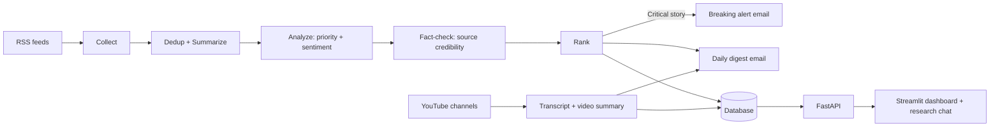

# AI Briefing Agent

> An autonomous multi-agent AI system that reads news and YouTube for you, analyzes everything with Google Gemini, and delivers a prioritized daily briefing, breaking-news alerts and a weekly intelligence report by email. It also ships a REST API, a Streamlit dashboard and a research chat that answers questions from the collected news with source citations (RAG).

**Status:** working end to end on a local machine, covered by 198 automated tests. Cloud deployment, personalization and social-media sources are still to do (see the roadmap below).

## Project summary

Keeping up with news means opening many sites, feeds and videos every day. This project does that work automatically:

1. **Collects** articles from RSS feeds and new videos (with transcripts) from YouTube channels.
2. **Merges** the same story reported by several outlets and **summarizes** it with Gemini.
3. **Analyzes** every story: priority (Critical / High / Medium / Low), sentiment, and how many independent sources confirm it.
4. **Delivers** a ranked daily email, an immediate alert for Critical stories and a weekly report with trending topics.
5. **Answers questions** about the collected news (also in Roman Urdu / Hinglish) with citations, and refuses to answer when the news does not contain the answer.

## Features

- **Collection:** RSS news feeds (BBC, Dawn, TechCrunch, Al Jazeera) and YouTube channels (RSS plus transcripts); one failing source never stops the rest
- **Deduplication:** the same story from several outlets is merged (TF-IDF and cosine similarity)
- **AI summaries:** 2-3 sentence story summaries; YouTube videos get a summary, key points and a takeaway; videos without a transcript are summarized from title and description and labelled as such
- **Analysis:** priority and sentiment for all stories in a single LLM call, with safe defaults if the model answers badly
- **Source credibility:** "Confirmed by N sources" (independent outlets) versus "Single source"
- **Breaking alerts:** an immediate email for Critical stories, never sent twice for the same story
- **Daily digest and weekly report:** ranked stories, YouTube highlights, trending topics (new / rising / falling) and a week-over-week comparison with an AI overview
- **Research chat (RAG):** semantic search with Gemini embeddings (cached in the database, TF-IDF fallback), answers with citations
- **API and dashboard:** FastAPI endpoints and a Streamlit dashboard (Stories, Videos, Stats, Chat)

## Architecture



The daily pipeline is orchestrated with **LangGraph**: conditional edges skip all work (and all API calls) when nothing is new, and add the alert step only when a Critical story exists. A second, lightweight graph runs every 30 minutes for breaking alerts and makes a single LLM call.

## Tech stack

Python 3.11, FastAPI, LangGraph, Google Gemini (summaries, analysis, embeddings), scikit-learn, SQLAlchemy (SQLite by default, PostgreSQL supported), APScheduler, Streamlit, feedparser, youtube-transcript-api, pytest, Docker Compose.

## Quick start

```bash
python -m venv venv
venv\Scripts\activate            # Windows (Linux/Mac: source venv/bin/activate)
pip install -r requirements.txt
copy .env.example .env           # then fill in your Gemini key and Gmail App Password
```

```bash
python -m app.scheduler --digest-now --all   # build and email a digest now
uvicorn app.main:app --reload                # API on http://127.0.0.1:8000/docs
streamlit run dashboard/app.py               # dashboard on http://localhost:8501
python -m app.scheduler                      # daily digest, 30-minute alerts, weekly report
python -m pytest tests -q                    # run the test suite
```

A Docker Compose setup (PostgreSQL, API, scheduler, dashboard) is included: `docker-compose up --build -d`.

## API

`GET /health`, `/stories`, `/articles`, `/stats`, `/videos`, `/weekly` and `POST /chat`, `/run-digest`, `/run-alerts`, `/run-videos`, `/run-weekly`. Interactive docs are served at `/docs`.

## Project structure

## Development progress

The project was built step by step, and each step was tested before moving on.

### Completed

| # | Step | What was built |
|---|------|----------------|
| 1 | Environment | Python 3.11, virtual environment, Git |
| 2 | Project structure | Package layout (agents, collectors, core, api, graph), tests folder |
| 3 | Configuration | pydantic-settings, secrets only in `.env` |
| 4 | RSS collector | Multiple feeds, HTML cleaning, failure-tolerant |
| 5 | Database and dedup | SQLAlchemy models, SQLite, TF-IDF and cosine similarity to merge duplicate stories |
| 6 | LLM summarization | Gemini summaries with a fallback to the original text |
| 7 | Pipeline | Collect, save, dedup, summarize; only new articles are processed |
| 8 | Email digest | HTML and plain-text email through Gmail SMTP |
| 9 | Scheduler | APScheduler daily job |
| 10 | Priority and sentiment | One LLM call classifies all stories; ranking by priority |
| 11 | Source credibility | Independent-outlet counting ("Confirmed by N sources") |
| 12 | LangGraph orchestrator | Shared state, nodes, conditional edges |
| 13 | Breaking alerts | Alert branch for Critical stories, no repeat alerts |
| 14 | Scheduler and graphs | Daily digest plus 30-minute alert check; state tracking so nothing is sent twice |
| 15 | REST API | FastAPI endpoints with background jobs |
| 16 | Research chat (RAG) | Retrieval, grounded answers with citations, Roman Urdu query rewriting, "not found" handling |
| 16b | Embeddings | Gemini embeddings cached in the database, relevance threshold, TF-IDF fallback |
| 17 | Dashboard | Streamlit app talking to the API |
| 18 | YouTube intelligence | Channel RSS, transcripts, summary, key points, takeaway, Shorts filter |
| 19 | Videos in email and dashboard | YouTube Highlights section, Videos tab |
| 20 | Weekly report | Trending topics, week-over-week comparison, AI overview, Sunday email |
| 21a | Docker and PostgreSQL support | Dockerfile, Compose file, database URL handling (the Compose stack is not yet verified end to end on the development machine) |
| 21b-0 | GitHub | Repository, README, `.env.example`, secret scan before pushing |

### Remaining roadmap

| Priority | Item | Notes |
|----------|------|-------|
| 1 | Cloud deployment (Render) | Free web services sleep when idle, so an always-on scheduler needs a paid instance; YouTube often blocks transcript requests from cloud IPs |
| 2 | Verify the Docker Compose stack | Run the full stack with PostgreSQL locally |
| 3 | Personalization | User interests and keywords, per-user ranking and feed |
| 4 | Social media sources | X, Facebook and Instagram APIs are paid or restricted; start with sources that have open official APIs |
| 5 | Claim-level fact-checking | An agent that compares individual claims across sources |
| 6 | Research agent | Multi-step deep dives on a topic |
| 7 | More notification channels | For example Telegram for breaking alerts |
| 8 | CI and demo | GitHub Actions running the tests, screenshots in the README |

## Design decisions

- **One LLM call for analysis:** all stories are classified together, which keeps free-tier quota usage low; a malformed answer falls back to safe defaults instead of breaking the pipeline.
- **Idempotent by design:** database tables remember which articles were digested and which stories were alerted, so reruns never repeat an email.
- **Testable agents:** every external dependency (LLM, SMTP, feeds, YouTube) is injected, so all 198 tests run offline with fakes.
- **Honest answers:** the research chat refuses when retrieval finds nothing relevant, and the prompt treats retrieved text as data, never as instructions.

## Notes and limitations

- Facebook, Instagram and X are not included because their APIs are restricted or paid.
- YouTube transcripts use the unofficial `youtube-transcript-api` library. It works locally, but YouTube often blocks cloud IP addresses.
- Emails are sent through Gmail SMTP with an App Password.
- Source credibility is rule-based (independent outlets that reported the story), not a claim-by-claim fact check.
- Priority and sentiment are AI judgments and can occasionally be wrong.
